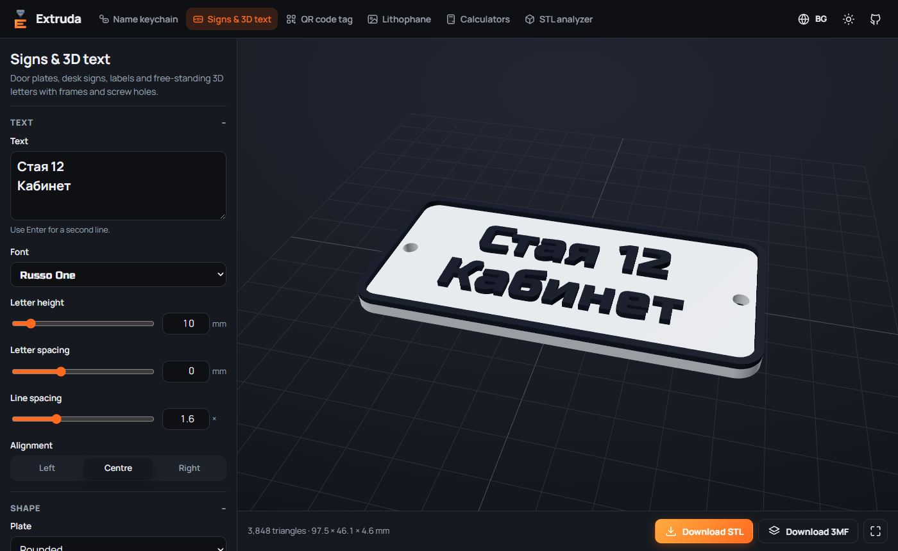
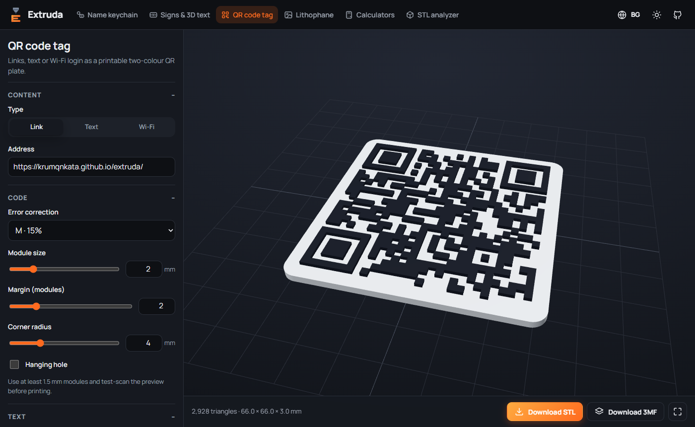
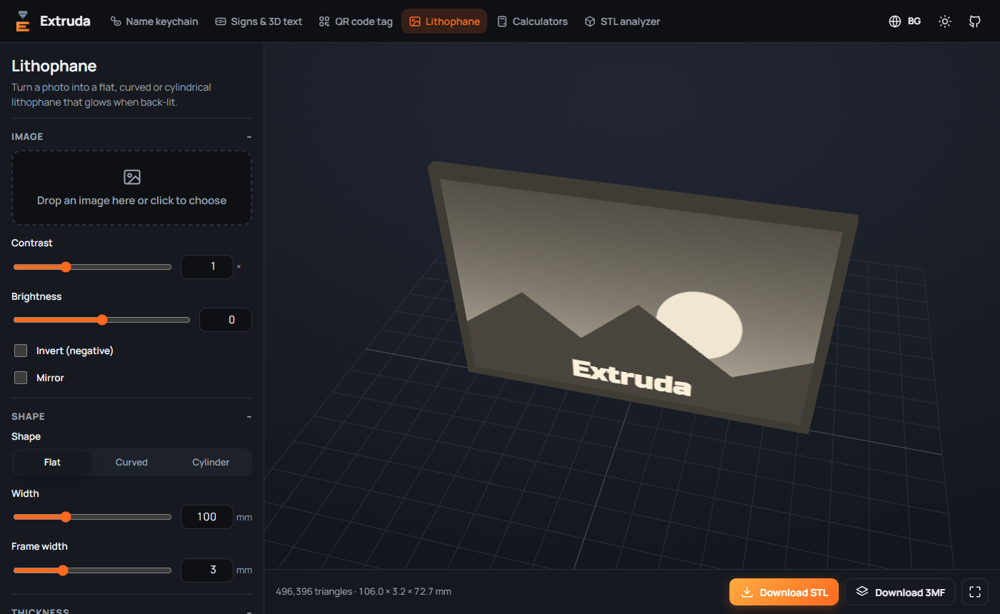
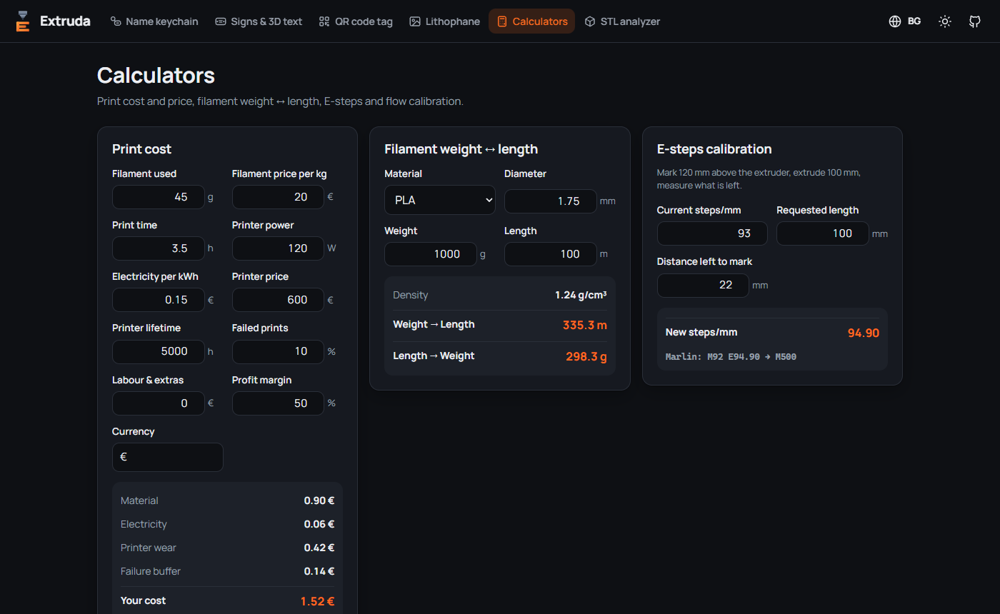

<div align="center">


# Extruda

**Your free 3D print workshop in the browser**<br/>
**Твоята безплатна 3D работилница в браузъра**

Name keychains · signs & 3D text · QR tags · lithophanes · print calculators · STL analyzer

[](https://krumqnkata.github.io/extruda/)

[](https://github.com/Krumqnkata/extruda/actions/workflows/deploy.yml)
[](LICENSE)


[English](#english) · [Български](#български)


</div>

---

## English

Extruda turns text and pictures into ready-to-print 3D models **right in your browser**. There's no
account, no upload and no install: the geometry is built on your device with WebAssembly, and you
download an STL or a multi-colour 3MF.

### Tools

| | Tool | What it does |
| --- | --- | --- |
| 🔑 | **Name keychain** | Type a name, choose one of 9 fonts, tune the border and key ring. Raised, engraved or flush-inlay text. **Batch mode** turns a list of names into a ZIP of STLs. |
| 🪧 | **Signs & 3D text** | Door plates, desk signs and labels: multi-line text, rounded/pill/text-following plates, frames, screw holes. Or just free-standing 3D letters. |
| 🔳 | **QR code tag** | Links, text or Wi-Fi login as a two-colour QR plate, with an optional label and hanging hole. Cyrillic content is encoded as UTF-8. |
| 🖼️ | **Lithophane** | Flat, curved or cylindrical lithophanes from any photo, with a back-lit preview, contrast/brightness, frame and detail control. |
| 🧮 | **Calculators** | Print cost & selling price (filament, electricity, printer wear, failures, margin), filament weight ↔ length, E-steps and flow calibration. |
| 📐 | **STL analyzer** | Open STL, 3MF or OBJ to see dimensions, volume, surface area, estimated weight, filament length and material cost. |

<table>
<tr>
<td></td>
<td></td>
</tr>
<tr>
<td></td>
<td></td>
</tr>
</table>

### Why it's nice

- **Private by design** – nothing you type or open leaves your device.
- **Watertight models** – built with the [Manifold](https://github.com/elalish/manifold) geometry kernel, so slicers never complain about holes or self-intersections.
- **Multi-colour ready** – the 3MF keeps text and base as separate parts, so Bambu Studio, OrcaSlicer and PrusaSlicer can assign a filament to each (AMS / MMU / colour swap).
- **Cyrillic and Latin** – every bundled font writes *Иван* as well as *Ivan*.
- **Bilingual UI** – Bulgarian and English, light and dark theme, works on phones.

### Printing tips

- Keychains: 0.2 mm layers, 3–4 walls. For two colours without an AMS, use *Raised* and add a filament change at the first text layer.
- Lithophanes: print standing up, 100% infill, 0.12–0.16 mm layers, white PLA.
- QR codes: modules of 1.5 mm or more; scan the on-screen preview before printing.

### Run it locally

Requires Node.js 22+.

```bash
git clone https://github.com/Krumqnkata/extruda.git
cd extruda
npm install
npm run dev
```

Open <http://localhost:5173/extruda/>. Other scripts: `npm test`, `npm run typecheck`, `npm run build`.
Every push to `main` is tested and deployed to GitHub Pages by [this workflow](.github/workflows/deploy.yml).

```
src/core/    geometry & maths: text outlines, model builders, lithophane mesh, STL/3MF export, calculators
src/tools/   one page per tool
src/i18n/    Bulgarian and English strings
tests/       Vitest: meshes must be watertight, numbers must add up
```

Want to help? See [CONTRIBUTING.md](CONTRIBUTING.md).

---

## Български

Extruda превръща текст и снимки в готови за принтиране 3D модели **директно в браузъра**. Без
регистрация, без качване, без инсталация: геометрията се изчислява на твоето устройство с
WebAssembly, а ти сваляш STL или многоцветен 3MF.

### Инструменти

| | Инструмент | Какво прави |
| --- | --- | --- |
| 🔑 | **Ключодържател с име** | Напиши име, избери един от 9 шрифта, настрой рамката и халката. Изпъкнал, гравиран или вграден текст. **Масов режим** – ZIP с STL за цял списък от имена. |
| 🪧 | **Табели и 3D текст** | Табели за врата и бюро, етикети: текст на няколко реда, заоблени/овални плочки или по формата на текста, рамка, отвори за винтове. Или само 3D букви. |
| 🔳 | **QR етикет** | Линк, текст или Wi-Fi достъп като двуцветна QR плочка с надпис и отвор за закачане. Кирилицата се кодира правилно (UTF-8). |
| 🖼️ | **Литофан** | Плосък, извит или цилиндричен литофан от снимка, с преглед „на светлина“, контраст, яркост, рамка и детайл. |
| 🧮 | **Калкулатори** | Себестойност и цена на принт (филамент, ток, амортизация, брак, печалба), тегло ↔ дължина на филамент, калибриране на E-steps и flow. |
| 📐 | **STL анализатор** | Отвори STL, 3MF или OBJ и виж размери, обем, повърхност, приблизително тегло, дължина на филамента и цена. |

### Защо е удобно

- **Поверителност** – нищо, което пишеш или отваряш, не напуска устройството ти.
- **Затворени (watertight) модели** – геометрията се строи с [Manifold](https://github.com/elalish/manifold), така че слайсърът няма да се оплаква от дупки.
- **Готово за многоцветен печат** – в 3MF файла текстът и основата са отделни части – за AMS, MMU или смяна на филамент.
- **Кирилица и латиница** – всички шрифтове пишат *Иван* толкова добре, колкото и *Ivan*.
- **Двуезичен интерфейс** – български и английски, светла и тъмна тема, работи и на телефон.

### Съвети за принтиране

- Ключодържатели: слоеве 0,2 мм, 3–4 стени. За два цвята без AMS избери *Изпъкнал* и добави смяна на филамента на първия слой от текста.
- Литофани: изправени, 100% запълване, слоеве 0,12–0,16 мм, бял PLA.
- QR кодове: модули поне 1,5 мм; сканирай прегледа на екрана, преди да принтираш.

### Локално стартиране

```bash
git clone https://github.com/Krumqnkata/extruda.git
cd extruda
npm install
npm run dev
```

---

## License / Лиценз

Extruda is free software under the **[GNU Affero General Public License v3.0 or later](LICENSE)**.
You may use, study, modify and share it, but if you distribute it or run a modified version as a
website, you must publish your full source code under the same license. Third-party components and
fonts are listed in [NOTICE.md](NOTICE.md).

**The models you generate are yours.** The license covers the code, not your STL/3MF files: print, share and sell them freely.

Extruda е свободен софтуер под лиценз **AGPL-3.0**. Можеш да го използваш, променяш и споделяш, но
ако го разпространяваш или пуснеш променена версия като сайт, трябва да публикуваш целия си код под
същия лиценз. **Моделите, които генерираш, са твои** – принтирай, споделяй и продавай свободно.

© 2026 Krumqnkata
