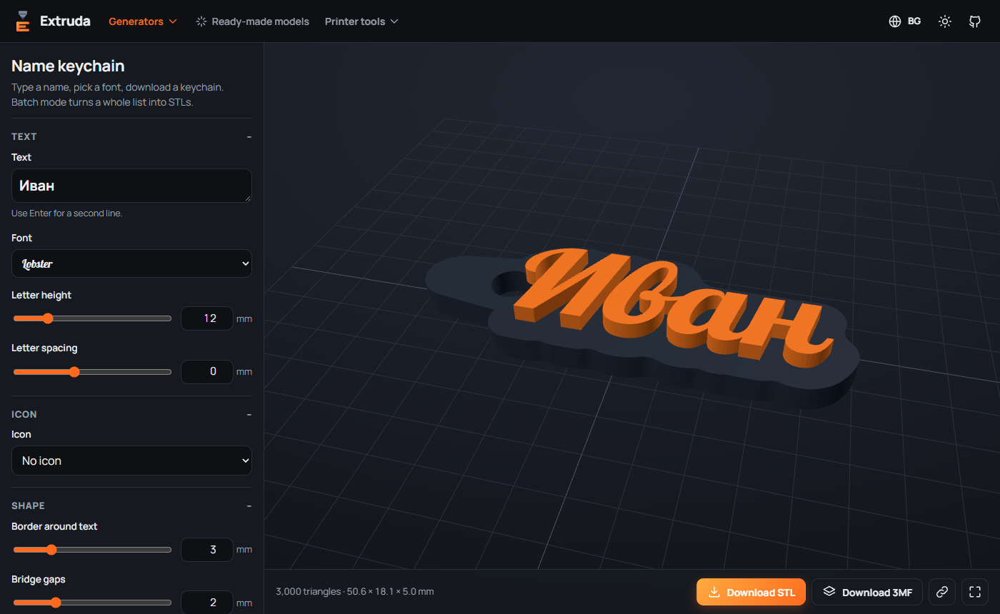
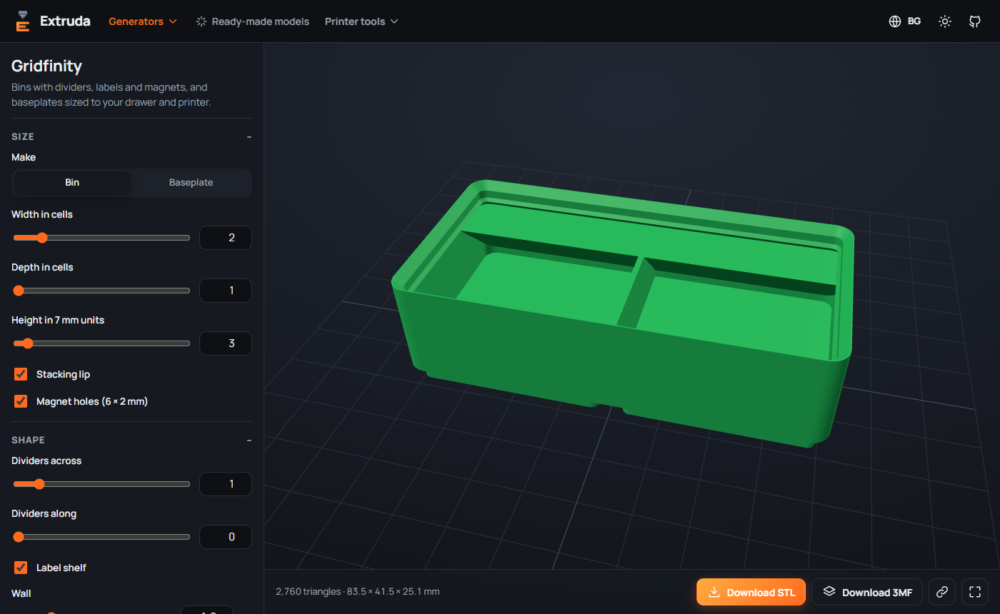
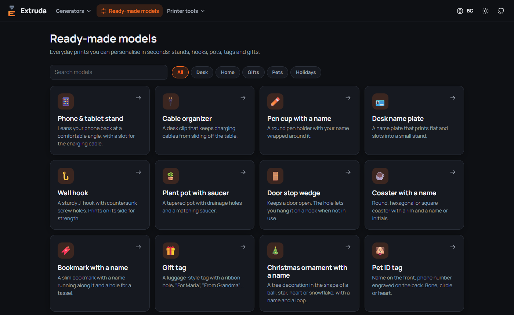
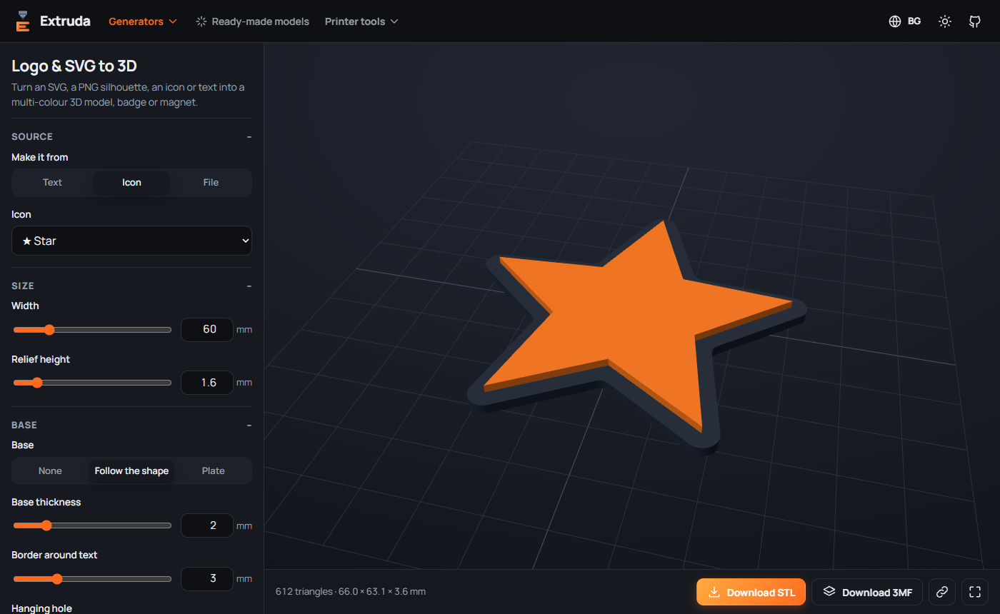
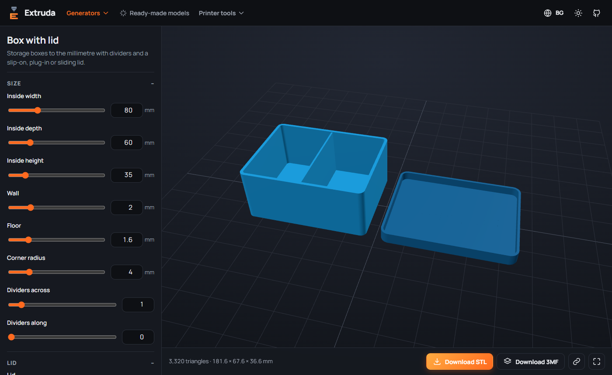
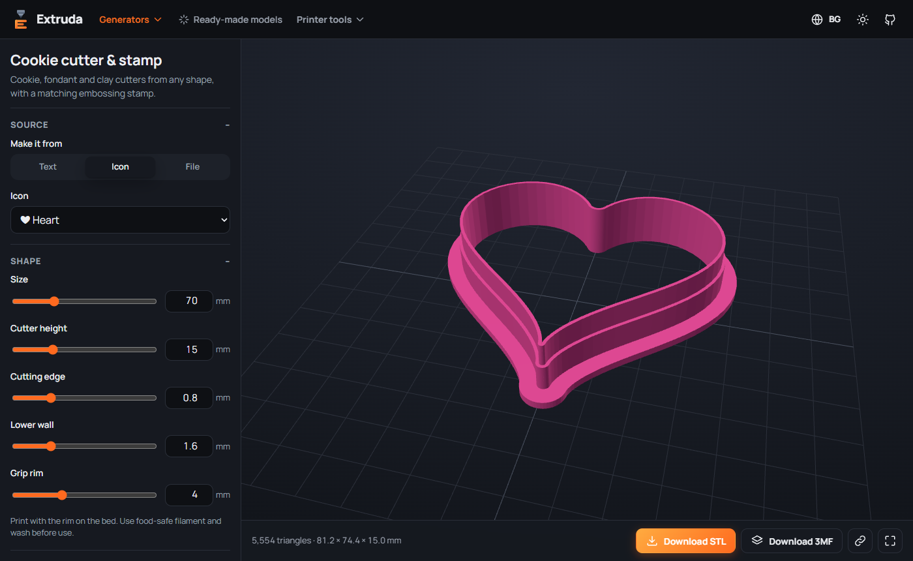
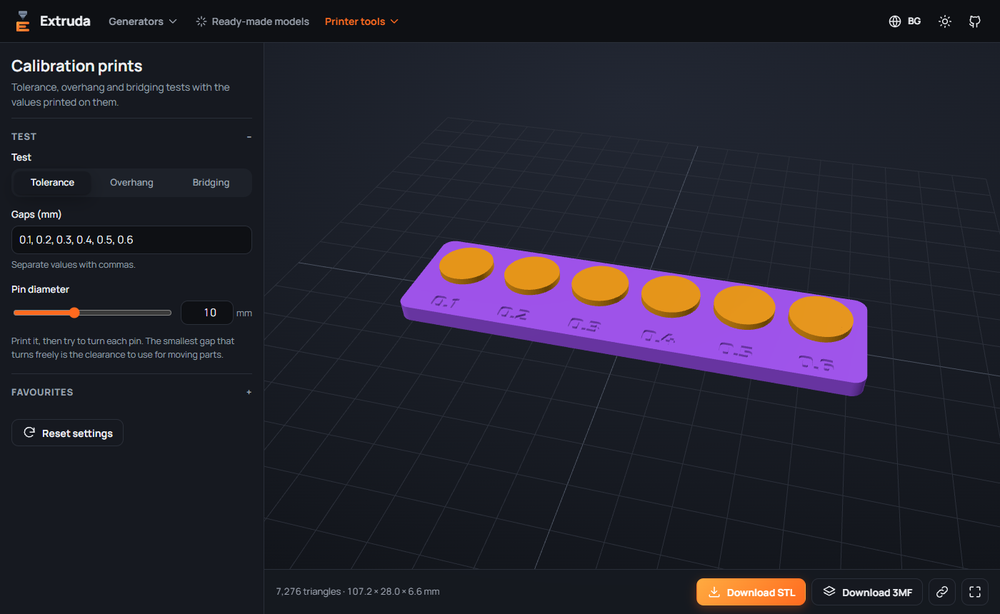

<div align="center">


# Extruda

**Your free 3D print workshop in the browser**<br/>
**Твоята безплатна 3D работилница в браузъра**

Keychains · logos from SVG · Gridfinity · boxes · cookie cutters · stencils · lithophanes · ready-made models · G-code colour change · calibration

[](https://krumqnkata.github.io/extruda/)

[](https://github.com/Krumqnkata/extruda/actions/workflows/deploy.yml)
[](LICENSE)


[English](#english) · [Български](#български)



</div>

---

## English

Extruda turns text and pictures into ready-to-print 3D models **right in your browser**. There's no
account, no upload and no install: the geometry is built on your device with WebAssembly, and you
download an STL or a multi-colour 3MF.

### Generators

| | Tool | What it does |
| --- | --- | --- |
| 🔑 | **Name keychain** | Type a name, pick one of 9 fonts, add an icon or your own SVG. Raised, engraved or flush-inlay text. **Batch mode** turns a list of names into a ZIP or a **full build plate** in one 3MF. |
| ⭐ | **Logo & SVG to 3D** | Upload an SVG (every colour becomes its own part) or a PNG silhouette, or use text or an icon. Badges, magnets, logos on a plate or contour base. |
| 🪧 | **Signs & 3D text** | Door plates, desk signs and labels: multi-line text, rounded/pill/text-following plates, frames, screw holes. Or free-standing 3D letters. |
| 🔳 | **QR code tag** | Links, text or Wi-Fi login as a two-colour QR plate with a label and hanging hole. Cyrillic is encoded as UTF-8. |
| 🗃️ | **Gridfinity** | Bins with dividers, label shelf, stacking lip and magnet holes, to the spec. **Baseplates sized to your drawer**, split automatically to fit your printer. |
| 📦 | **Box with lid** | Boxes to the millimetre with dividers and a slip-on, plug-in or sliding lid, adjustable clearance and engraved or inlaid lid text. |
| 🍪 | **Cookie cutter & stamp** | Cutters from text, icons, SVG or PNG with a thin cutting edge and grip rim, plus a matching embossing stamp. |
| ✂️ | **Stencil** | Text or artwork cut out of a plate, with automatic bridges so the middles of O, A, P and B stay in place. |
| 🖼️ | **Lithophane** | Flat, curved or cylindrical lithophanes from any photo, with a back-lit preview. |
| 🎨 | **Filament art** | A photo in shades of colour from a few filament swaps, with an estimated preview and the heights to change at. |
| 🏔️ | **3D map** | Real terrain of any area. The only tool that uses the internet: it asks for the chosen area from a public elevation service, and only when you press the button. |

### Ready-made models

A gallery of everyday prints you personalise in seconds: a dual-name illusion that reads one name from the front and
another from the side, rings and bracelets with a name, a perpetual desk calendar, phone & tablet stand, cable organizer,
pen cup with a name wrapped around it, desk name plate with stand, wall hook, plant pot with saucer, door wedge, coaster,
bookmark, gift tag, Christmas ornament and a two-sided pet ID tag.

### Parts

| | Tool | What it does |
| --- | --- | --- |
| ⚙️ | **Gears** | Involute spur or helical gears by module and tooth count, with a matching second gear, axle distance and ratio. |
| 🔩 | **Bolts & nuts** | ISO metric threads from M3 to M30 with clearance you can tune. Not for loads or anything safety-related. |
| 🧰 | **Pegboard holders** | Hooks, bins and tool holders for Skådis-style boards and standard pegboards. Measure your board and print one first. |
| 📟 | **Electronics enclosure** | Standoffs, port openings and a vented lid. Raspberry Pi 4 profile from the official drawing, or enter your own board. |
| 🚪 | **Hinge & snap-fit clip** | A hinge that prints assembled and a clip with flexible arms. |

### STL tools

| | Tool | What it does |
| --- | --- | --- |
| 🩺 | **Check & repair** | Finds holes, flipped faces, overhangs and thin walls. Repairs what it can and says so when it cannot. |
| 🔁 | **Convert & simplify** | STL, 3MF and OBJ, with scaling, mirroring, turning and fewer triangles. |
| 🧭 | **Auto orient** | Suggests how to lay a model on the bed so it needs the least support. |
| ✂️ | **Cut to fit the bed** | Splits a model too big for your printer into pieces, with sockets and dowels for joining. |
| 📐 | **STL analyzer** | Size, volume, estimated weight and cost, then send the grams to the calculators. |

### Printer tools

| | Tool | What it does |
| --- | --- | --- |
| 🎨 | **G-code colour change** | Open a `.gcode` from PrusaSlicer, OrcaSlicer, Cura or Bambu Studio, pick heights, and Extruda inserts `M600`, `PAUSE`, `M601` or `M0`. Preview the print layer by layer with the colours. |
| 📏 | **Calibration prints** | Print-in-place tolerance test, overhang test and bridging test, each with its values printed on it. |
| 🏷️ | **Filament swatches** | Labelled sample cards with a 0.4–2.0 mm thickness staircase; a whole list goes onto one plate. |
| 🧮 | **Calculators** | Print cost & price, filament weight ↔ length, filament left on a spool, E-steps and flow calibration. |
| 🧵 | **Filament stock & log** | Your spools, what is left on each and what every print used and cost. Stored only in your browser, with backup export. |
| 📖 | **Guide & troubleshooting** | Typical settings per material and fixes for common print problems, with search. |
| 🧾 | **Customer quote** | A quote with your logo and prices, saved as PDF from the browser. Not a tax invoice. |

<table>
<tr>
<td></td>
<td></td>
</tr>
<tr>
<td></td>
<td></td>
</tr>
<tr>
<td></td>
<td></td>
</tr>
</table>

### Why it's nice

- **Private by design** – nothing you type or open leaves your device. The one exception is the 3D map, which says so on the page.
- **Watertight models** – built with the [Manifold](https://github.com/elalish/manifold) geometry kernel, so slicers never complain about holes or self-intersections.
- **Multi-colour ready** – the 3MF keeps text and base as separate parts, so Bambu Studio, OrcaSlicer and PrusaSlicer can assign a filament to each (AMS / MMU / colour swap).
- **Cyrillic and Latin** – every bundled font writes *Иван* as well as *Ivan*.
- **Bilingual UI** – Bulgarian and English, light and dark theme, works on phones.
- **Share a design as a link** – the settings travel in the URL (Wi-Fi passwords never do). Save favourite settings per tool.
- **Works offline** – install it as an app; tools, fonts and the geometry engine are cached.

### Printing tips

- Keychains: 0.2 mm layers, 3–4 walls. For two colours without an AMS, use *Raised*, slice, then let the **G-code colour change** tool add the change at the base thickness.
- Gridfinity and boxes: check your clearance with the **tolerance test** first.
- Lithophanes: print standing up, 100% infill, 0.12–0.16 mm layers, white PLA.
- QR codes: modules of 1.5 mm or more; scan the on-screen preview before printing.

### Run it locally

Requires Node.js 22+.

```bash
git clone https://github.com/Krumqnkata/extruda.git
cd extruda
npm install
npm run dev
```

Open <http://localhost:5173/extruda/>. Other scripts: `npm test`, `npm run typecheck`, `npm run build`.
Every push to `main` is tested and deployed to GitHub Pages by [this workflow](.github/workflows/deploy.yml).

```
src/core/    geometry & maths: text, SVG, image tracing, model builders, Gridfinity, G-code, STL/3MF export
src/models/  ready-made models gallery (one entry per model)
src/tools/   one page per tool
src/i18n/    Bulgarian and English strings
tests/       Vitest: meshes must be watertight, numbers must add up
```

Want to help? See [CONTRIBUTING.md](CONTRIBUTING.md).

---

## Български

Extruda превръща текст и снимки в готови за принтиране 3D модели **директно в браузъра**. Без
регистрация, без качване, без инсталация: геометрията се изчислява на твоето устройство с
WebAssembly, а ти сваляш STL или многоцветен 3MF.

### Генератори

| | Инструмент | Какво прави |
| --- | --- | --- |
| 🔑 | **Ключодържател с име** | Напиши име, избери шрифт, добави иконка или свой SVG. Изпъкнал, гравиран или вграден текст. **Масов режим** – ZIP или **пълна плоча** в един 3MF. |
| ⭐ | **Лого и SVG в 3D** | Качи SVG (всеки цвят става отделна част) или силует от PNG, или използвай текст или иконка. Значки, магнити, лога. |
| 🪧 | **Табели и 3D текст** | Табели за врата и бюро, етикети, рамка, отвори за винтове, или само 3D букви. |
| 🔳 | **QR етикет** | Линк, текст или Wi-Fi като двуцветна QR плочка с надпис и отвор. |
| 🗃️ | **Gridfinity** | Кутийки с прегради, лайсна за етикет, борд и гнезда за магнити по спецификацията. **Основи по мярка на чекмеджето**, разделени автоматично според принтера. |
| 📦 | **Кутия с капак** | Кутии до милиметър с прегради и нахлузващ, вграден или плъзгащ капак, настройваема хлабина и надпис на капака. |
| 🍪 | **Калъп за сладки и печат** | Калъпи от текст, иконка, SVG или PNG с тънък режещ ръб и ръб за хващане, плюс печат за релеф. |
| ✂️ | **Шаблон (стенцил)** | Текст или рисунка, изрязани от плочка, с автоматични мостчета, за да не падат средите на О, А, Р и Б. |
| 🖼️ | **Литофан** | Плосък, извит или цилиндричен литофан от снимка с преглед „на светлина“. |
| 🎨 | **Картина от филамент** | Снимка в нюанси само с няколко смени на филамента, с приблизителен преглед и височините за смяна. |
| 🏔️ | **3D карта** | Истинският релеф на всяка област. Единственият инструмент, който ползва интернет: изисква избраната област от публична услуга и то само когато натиснеш бутона. |

### Готови модели

Галерия с полезни предмети, които персонализираш за секунди: двойна илюзия, която отпред чете едно име, а отстрани друго,
пръстени и гривни с име, вечен календар за бюро, стойка за телефон и таблет, органайзер за кабели, чаша за моливи с име,
табелка с име за бюро, кукичка за стена, саксия с подложка, клин за врата, подложка за чаша, отметка за книга,
етикет за подарък, коледна играчка и двустранен медальон за домашен любимец.

### Части

| | Инструмент | Какво прави |
| --- | --- | --- |
| ⚙️ | **Зъбни колела** | Еволвентни прави или скосени колела по модул и брой зъби, с второ колело, разстояние между осите и предавателно число. |
| 🔩 | **Винтове и гайки** | Метрична резба от M3 до M30 с настройваема хлабина. Не е за товари и нищо свързано с безопасност. |
| 🧰 | **Държачи за перфорирана дъска** | Кукички, кутийки и държачи за дъски тип Skådis и стандартни дъски. Измери дъската и първо принтирай един. |
| 📟 | **Кутия за електроника** | Стойки, отвори за портове и проветрив капак. Профил за Raspberry Pi 4 по официалния чертеж или твоя платка. |
| 🚪 | **Панта и щракаща закопчалка** | Панта, която се принтира сглобена, и закопчалка с гъвкави рамена. |

### STL инструменти

| | Инструмент | Какво прави |
| --- | --- | --- |
| 🩺 | **Проверка и поправка** | Намира дупки, обърнати стени, надвеси и тънки стени. Поправя каквото може и казва, когато не може. |
| 🔁 | **Конвертор и опростяване** | STL, 3MF и OBJ, с мащаб, огледало, завъртане и по-малко триъгълници. |
| 🧭 | **Автоматична ориентация** | Предлага как да легне моделът на плочата, за да иска най-малко подпори. |
| ✂️ | **Рязане по плочата** | Разделя твърде голям модел на части с гнезда и щифтове за сглобяване. |
| 📐 | **STL анализатор** | Размери, обем, тегло и цена, с прехвърляне към калкулаторите. |

### Инструменти за принтера

| | Инструмент | Какво прави |
| --- | --- | --- |
| 🎨 | **Смяна на цвят в G-code** | Отвори `.gcode` от PrusaSlicer, OrcaSlicer, Cura или Bambu Studio, избери височини и Extruda добавя `M600`, `PAUSE`, `M601` или `M0`. Прегледай принта слой по слой с цветовете. |
| 📏 | **Калибрационни тестове** | Тест за хлабина (принтира се наведнъж), за надвес и за мостове, с отпечатани стойности. |
| 🏷️ | **Мостри на филамент** | Надписани мостри със стъпала 0,4–2,0 мм; цял списък на една плоча. |
| 🧮 | **Калкулатори** | Цена на принт, тегло ↔ дължина, оставащ филамент на масура, E-steps и flow. |
| 🧵 | **Склад за филамент и дневник** | Масурите ти, колко е останало на всяка и какво е струвал всеки принт. Пази се само в браузъра, с резервно копие. |
| 📖 | **Справочник и проблеми** | Типични настройки за всеки материал и решения за честите проблеми, с търсене. |
| 🧾 | **Оферта за клиент** | Оферта с твоето лого и цени, запазена като PDF от браузъра. Не е данъчна фактура. |

### Защо е удобно

- **Поверителност** – нищо, което пишеш или отваряш, не напуска устройството ти. Единственото изключение е 3D картата и това пише на страницата ѝ.
- **Затворени (watertight) модели** – геометрията се строи с [Manifold](https://github.com/elalish/manifold), така че слайсърът няма да се оплаква от дупки.
- **Готово за многоцветен печат** – в 3MF файла текстът и основата са отделни части – за AMS, MMU или смяна на филамент.
- **Кирилица и латиница** – всички шрифтове пишат *Иван* толкова добре, колкото и *Ivan*.
- **Двуезичен интерфейс** – български и английски, светла и тъмна тема, работи и на телефон.
- **Споделяне с линк** – настройките са в адреса (паролите за Wi-Fi никога). Любими настройки за всеки инструмент.
- **Работи офлайн** – инсталирай го като приложение; инструментите, шрифтовете и 3D двигателят се кешират.

### Съвети за принтиране

- Ключодържатели: слоеве 0,2 мм, 3–4 стени. За два цвята без AMS избери *Изпъкнал*, нарежи и остави **Смяна на цвят в G-code** да добави смяната на височината на основата.
- Gridfinity и кутии: първо провери хлабината с **теста за хлабина**.
- Литофани: изправени, 100% запълване, слоеве 0,12–0,16 мм, бял PLA.
- QR кодове: модули поне 1,5 мм; сканирай прегледа на екрана, преди да принтираш.

### Локално стартиране

```bash
git clone https://github.com/Krumqnkata/extruda.git
cd extruda
npm install
npm run dev
```

---

## License / Лиценз

Extruda is free software under the **[GNU Affero General Public License v3.0 or later](LICENSE)**.
You may use, study, modify and share it, but if you distribute it or run a modified version as a
website, you must publish your full source code under the same license. Third-party components and
fonts are listed in [NOTICE.md](NOTICE.md).

**The models you generate are yours.** The license covers the code, not your STL/3MF files: print, share and sell them freely.

Extruda е свободен софтуер под лиценз **AGPL-3.0**. Можеш да го използваш, променяш и споделяш, но
ако го разпространяваш или пуснеш променена версия като сайт, трябва да публикуваш целия си код под
същия лиценз. **Моделите, които генерираш, са твои** – принтирай, споделяй и продавай свободно.

© 2026 Krumqnkata
